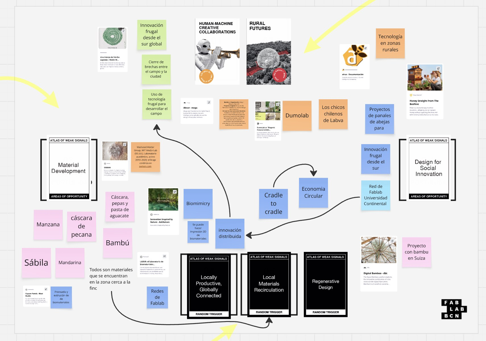

---
hide:
    - toc
---

# De un interés suelto a un territorio

##Abrir en vez de cerrar
El módulo propuso un proceso divergente. No se trataba de llegar rápido a una solución, sino de abrir el campo y ver qué aparecía.
Llegué con un interés, no con un proyecto. Sabía que me movían los biomateriales y lo que pasa en el campo, pero eso es un tema, no una dirección. Al cerrar la semana tenía otra cosa: un territorio con bordes, con referentes y con nombres propios.

##Las cartas
Trabajé el ejercicio de Weak Signals con la baraja del Atlas of Weak Signals de Fab Lab Barcelona.
Las cartas funcionan como detonantes. Cada una obliga a mirar el mismo interés desde un ángulo que uno no habría elegido solo, y ahí está su valor: no te dejan volver a la respuesta cómoda. Elegí las que me hablaban —ruralidad, innovación frugal, biomateriales, circularidad, diseño regenerativo— y empecé a conectar puntos sobre el tablero: materiales, tecnologías, organizaciones, fuentes de inspiración

{ width="300" style="display: block; margin: auto" }
<em>Señales débiles, áreas de oportunidad, materiales y referentes sobre un mismo tablero.</em>

