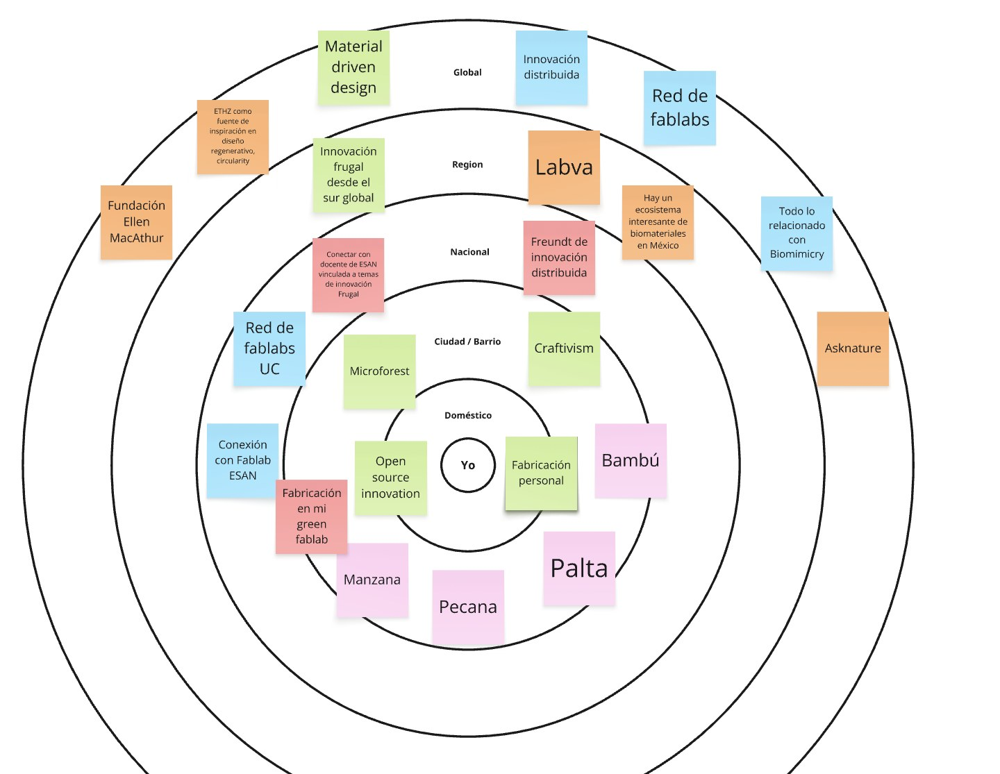
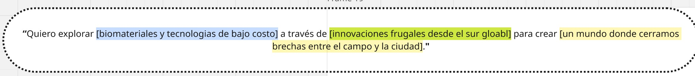

---
hide:
    - toc
---

# De un interés suelto a un territorio

##**Abrir en vez de cerrar**
El módulo propuso un proceso divergente. No se trataba de llegar rápido a una solución, sino de abrir el campo y ver qué aparecía.
Llegué con un interés, no con un proyecto. Sabía que me movían los biomateriales y lo que pasa en el campo, pero eso es un tema, no una dirección. Al cerrar la semana tenía otra cosa: un territorio con bordes, con referentes y con nombres propios.

##**Las cartas**
Trabajé el ejercicio de Weak Signals con la baraja del Atlas of Weak Signals de Fab Lab Barcelona.
Las cartas funcionan como detonantes. Cada una obliga a mirar el mismo interés desde un ángulo que uno no habría elegido solo, y ahí está su valor: no te dejan volver a la respuesta cómoda. Elegí las que me hablaban —ruralidad, innovación frugal, biomateriales, circularidad, diseño regenerativo— y empecé a conectar puntos sobre el tablero: materiales, tecnologías, organizaciones, fuentes de inspiración

{ width="600" style="display: block; margin: auto" }
<em style="color: gray; font-size: 12px">Señales débiles, áreas de oportunidad, materiales y referentes sobre un mismo tablero.</em>

De ahí salieron mis dos frentes de trabajo.
El primero son los residuos agrícolas locales como materia prima: manzana, pecana, palta, sábila, mandarina, bambú. Todos a poca distancia de la finca. El segundo son las tecnologías de bajo costo para el campo, innovando en las herramientas que ya se usan en la zona, por ejemplo con los panales de abejas.

##**Glocal**
Hay un término que me sigue dando vueltas: glocal.
Me interesa cómo se innova desde lo local —con lo que hay cerca, con los residuos de la finca, con el conocimiento del lugar— y cómo eso puede escalar a una conversación global sin perder su esencia. No es una palabra bonita. Es el criterio con el que voy a decidir qué vale la pena hacer.
También me mueve la pregunta del futuro rural: cómo van a ser estas zonas en veinte años. La carta de Human-Machine Creative Collaborations me dejó pensando en esa combinación creativa entre la tecnología y el lado más humano.

##**Años guardando referencias**
Para rastrear referentes me apoyé en Claude y en Gemini. Pero la fuente más útil fue otra.
Llevo varios años alimentando una base de datos en Airtable donde voy guardando referencias de los temas que me interesan. Varias de las que usé en este ejercicio salieron de ahí. Lo que durante años fue un archivo sin destino, esta semana por fin tuvo dónde aterrizar.
Es un proceso vivo y lo voy a seguir nutriendo. Lo que ya me dio fue justamente eso: gatillar intereses concretos y encontrar organizaciones que llevan años haciendo cosas increíbles en estos temas.

##**El mapa que cambió el ejercicio**
Ordené todo lo anterior en un espacio de diseño multiescalar: Yo → Doméstico → Ciudad/Barrio → Nacional → Región → Global.
Este paso fue el que más me sirvió. Hasta entonces tenía una lista de intereses; al ubicarlos por escala se volvió un mapa concreto de con quién puedo trabajar en cada capa. La red de fablabs de la Universidad Continental y el Fab Lab ESAN dejaron de ser nombres sueltos y pasaron a ser vecinos. LABVA y la Fundación Ellen MacArthur quedaron en los anillos de afuera: no están al alcance de la mano, pero ya sé en qué dirección quedan.

{ width="600" style="display: block; margin: auto" }
<em style="color: gray; font-size: 12px">Recursos, infraestructura y referentes ordenados por escala, desde "Yo" hasta lo global.</em>

##**Una frase que todavía se mueve**
Con el mapa encima escribí la declaración tentativa del proyecto, construida sobre tres preguntas: cuál es mi problema o interés actual, qué señales y metáforas me hicieron repensar, y qué quiero prototipar.

*«Quiero explorar biomateriales y tecnologías de bajo costo a través de innovaciones frugales desde el sur global para crear un mundo donde cerramos brechas entre el campo y la ciudad.»*

{ width="600" style="display: block; margin: auto" }
<em style="color: gray; font-size: 12px">El ejercicio tal como quedó en el tablero, con sus tres campos.</em>

La escribo sabiendo que va a cambiar. Es una primera versión y espero revisarla conforme avance el programa. Pero ya sirve para lo que tiene que servir: cuando aparezca una idea nueva, tengo contra qué contrastarla.

##**Herramientas**
Miro para los tres ejercicios. Las cartas del Atlas of Weak Signals de Fab Lab Barcelona como baraja de detonantes. Claude, Gemini y mi base de Airtable para rastrear referentes.

##**Proyectos y personas de referencia**

[Oxman](https://www.oxman.com/)
Neri Oxman trabaja en la frontera entre diseño, biología y fabricación digital. Es mi referencia de ambición: demuestra que un material puede diseñarse desde su lógica biológica, no darse por hecho.

[Asknature](https://asknature.org/)
Base de datos de estrategias biológicas. Cuando me atasque con un problema técnico —cómo unir, cómo impermeabilizar, cómo dar estructura— acá busco cómo lo resolvió la naturaleza primero. Es la más práctica de esta lista.

[DigitalBamboo-ETHZurich](https://dbt.arch.ethz.ch/project/digital-bamboo/)
Pabellón que combina bambú con fabricación digital. Resuelve exactamente mi tensión: un material local y humilde, procesado con herramientas de precisión. Prueba de que la combinación funciona a escala construida.

[Dumolab](https://www.design.upenn.edu/post/dumolab-biogenic-futures-exhibit-women-shaping-material-ecologies-uc-boulder-museum-art)
Laboratorio de ecologías materiales. Referencia metodológica: cómo se investiga un biomaterial con rigor y, sobre todo, cómo se documenta ese proceso.

[Mogu](https://mogu.bio/about/)
Empresa que fabrica productos comerciales a partir de micelio. Es mi referencia de aterrizaje: muestra el salto del prototipo de laboratorio al producto que se vende. Cuando tenga que pensar en viabilidad, miro acá.

##**Archivos**
Los tres ejercicios están en un solo tablero de Miro, en el orden en que los trabajé.
(www.miro.com/app/board/uXjVHoVOrq4=) 
