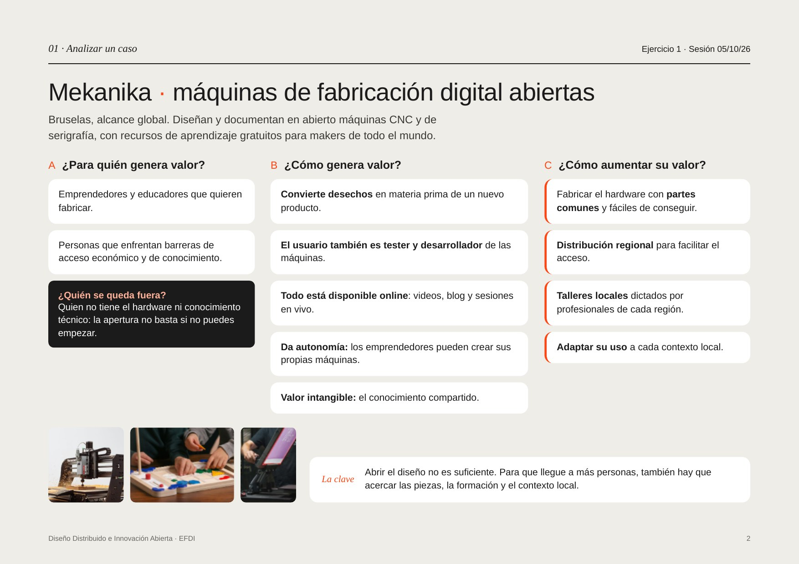
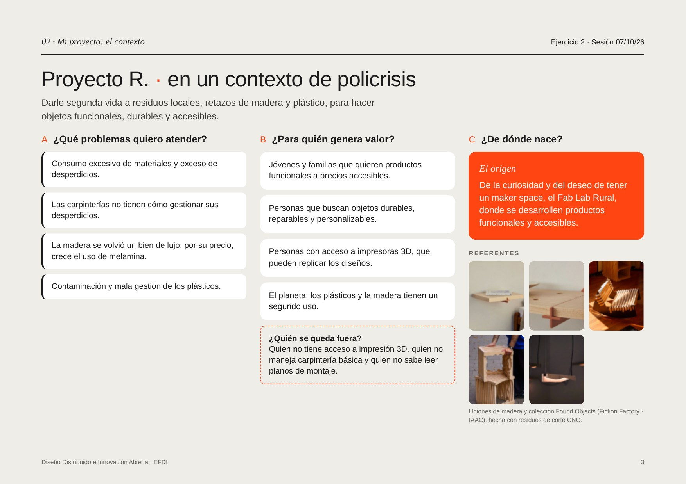
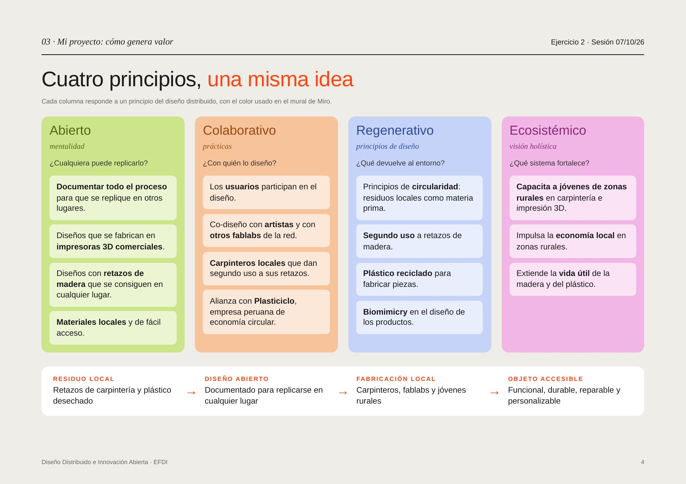
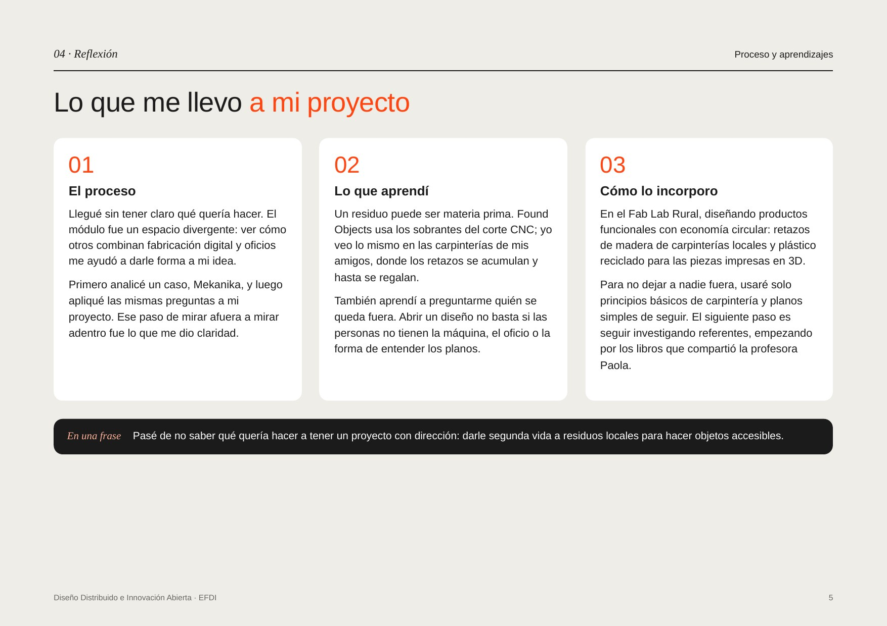

---
hide:
    - toc
---

# MI01

#**Mirar afuera para mirar adentro**

##**Por qué cambié de foco**

Este módulo me sirvió para aterrizar el proyecto, y en el camino cambié por dónde entrar.
Lo que no cambió es el fondo. Desde que empecé el programa me interesa la circularidad y los principios de cradle to cradle: que las cosas no terminen en la basura, sino que vuelvan a entrar al ciclo. Eso sigue siendo la base de lo que quiero hacer.
Lo que sí cambió es el material. En el módulo anterior entré por los biomateriales. Es un tema que me gusta y que quiero ir explorando de a pocos, pero para este proyecto, ahora, no era lo más pertinente.
Mientras tanto estoy haciendo carpintería. Voy a dos talleres y en los dos me pasó lo mismo: ver cómo se van juntando retazos de madera que nadie usa y que al final se pierden. Cada vez que iba me quedaba mirando eso. Es un desperdicio que está a la vista.
Así que el proyecto se fue para ese lado: dar acceso a productos de madera hechos con retazos, combinados con impresión 3D. La idea de fondo es la misma, aprovechar lo que ya está ahí, pero con un material que tengo cerca y que estoy aprendiendo a trabajar.

##**Dos sesiones**
Fueron dos sesiones con Paola Zanchetta.La primera sirvió para abrir el tema: de dónde viene el movimiento open source, qué significa diseño distribuido y cuáles son los cuatro valores de la Distributed Design Platform. Abierto, colaborativo, regenerativo y ecosistémico. En la segunda bajamos esos cuatro valores a casos concretos, como Domingo Club, Brenchies Lab en Aruba, Totomoxtle y Precious Plastic.
El ejercicio venía en dos partes, y ahí estuvo lo interesante. Primero había que analizar el proyecto de otra gente con un set de preguntas. Después, hacerse esas mismas preguntas a uno mismo. Mirar afuera fue lo que me ayudó a mirar adentro.

##**Mekanika: abrir no es lo mismo que llegar**
Para la primera parte analicé [Mekanika](https://www.mekanika.io/), un proyecto que diseña y documenta en abierto máquinas CNC y de serigrafía, y que además comparte material de aprendizaje gratuito.
Mekanika publica absolutamente todo: videos, blog, sesiones en vivo. Cualquiera puede entrar y verlo. Pero al analizarlo me di cuenta de que verlo no alcanza. Si no tienes el hardware ni el conocimiento técnico, te quedas fuera igual.
De ahí salió lo que para mí fue la clave del ejercicio: abrir el diseño no es suficiente. Para que llegue a más gente hay que acercarle también las piezas, la formación y el contexto local.
Las mejoras que propuse van por ese lado. Usar partes comunes y fáciles de conseguir, distribuir por regiones, hacer talleres dictados por gente de cada zona y adaptar el uso a cada contexto.

{ width="600" style="display: block; margin: auto" }<em style="color: gray; font-size: 12px">Ejercicio 1: para quién genera valor, cómo, y qué le falta.</em>

##**La pregunta que no me hacía**
Paola insistió mucho en una pregunta: ¿quién se queda fuera?
Nunca me la había hecho. Y cuando se la hice a Mekanika, me tocó hacérmela a mí.
Mi respuesta fue bastante clara: quien no tiene acceso a una impresora 3D, quien no maneja carpintería básica y quien no sabe leer planos de montaje. Escribirlo me cambió el diseño, porque a partir de ahí decidí usar solo carpintería sencilla y planos fáciles de seguir.

##**Alguien ya lo estaba haciendo**
En la primera sesión Paola mostró Found Objects, un proyecto de Fiction Factory con el IAAC y el artista Jesse Howard. Es una colección de productos hecha con los sobrantes del corte CNC.
Me sirvió mucho verlo, porque confirmaba lo que yo ya venía notando en los talleres. No era una idea que se me había ocurrido de la nada: ya hay gente trabajando así y les funciona.

##**Proyecto R.**
La idea es darle segunda vida a retazos de madera y plástico para hacer objetos funcionales, durables y accesibles.
La madera es el cuerpo del objeto, y la impresión 3D son las piezas que lo unen, hechas con plástico reciclado. Esa combinación es la que permite que el diseño se pueda replicar en otro lado, porque los retazos se consiguen en cualquier carpintería y las piezas se imprimen donde haya una máquina.
Nace de la curiosidad y de las ganas de tener un maker space propio, el Fab Lab Rural, donde se puedan hacer productos funcionales y accesibles.
Los problemas que quiere atender están conectados entre sí: usamos demasiado material y generamos demasiado desperdicio, las carpinterías no tienen cómo manejar sus retazos, la madera se volvió cara y eso empuja a usar melamina, y los plásticos siguen mal gestionados.
En cuanto a para quién es, pienso en jóvenes y familias que buscan productos a precio accesible, en quien quiere objetos durables y reparables, y en quien tiene impresora 3D y puede replicar los diseños. Y también en el planeta: son dos materiales que reciben un segundo uso.

{ width="600" style="display: block; margin: auto" }<em style="color: gray; font-size: 12px">Ejercicio 2: problemas, destinatarios y origen del proyecto.</em>

##**Los cuatro principios**
La segunda parte del ejercicio fue pasar el proyecto por los cuatro valores del diseño distribuido.
**Abierto**. Documentar todo el proceso para que alguien lo pueda repetir en otro lugar, con diseños que se impriman en impresoras 3D comunes y que usen retazos conseguibles en cualquier parte.
**Colaborativo**. Que los usuarios participen en el diseño, co-diseñar con artistas y con otros fablabs de la red, y trabajar con los carpinteros que dan segundo uso a sus retazos. También la alianza con Plasticiclo, una empresa peruana de economía circular.
**Regenerativo**. Residuos locales como materia prima, segundo uso a los retazos, plástico reciclado para las piezas impresas y biomimicry en el diseño de los productos.
**Ecosistémico**. Capacitar a jóvenes de zonas rurales en carpintería e impresión 3D, mover la economía local y alargar la vida útil de la madera y el plástico.
Visto todo junto, el proyecto es una cadena corta:
*residuo local → diseño abierto → fabricación local → objeto accesible*

{ width="600" style="display: block; margin: auto" }<em style="color: gray; font-size: 12px">Cada columna responde a un principio, con el color usado en el tablero de Miro.</em>

##**Lo que me llevo**
Me quedo con dos cosas.
La primera es que un residuo puede ser materia prima. Escrito así suena obvio, pero una cosa es leerlo y otra es verlo funcionando en Found Objects y después reconocerlo en los retazos de los talleres donde voy. Ahí recién se me hizo real.
La segunda es la pregunta de quién se queda fuera. Abrir un diseño no sirve de mucho si la gente no tiene la máquina, el oficio o la forma de entender los planos. Esa pregunta me la llevo a los módulos que vienen.
Si tuviera que resumirlo en una frase: pasé de no saber qué quería hacer a tener un proyecto con dirección.

{ width="600" style="display: block; margin: auto" }<em style="color: gray; font-size: 12px">Proceso, aprendizajes y próximos pasos.</em>

