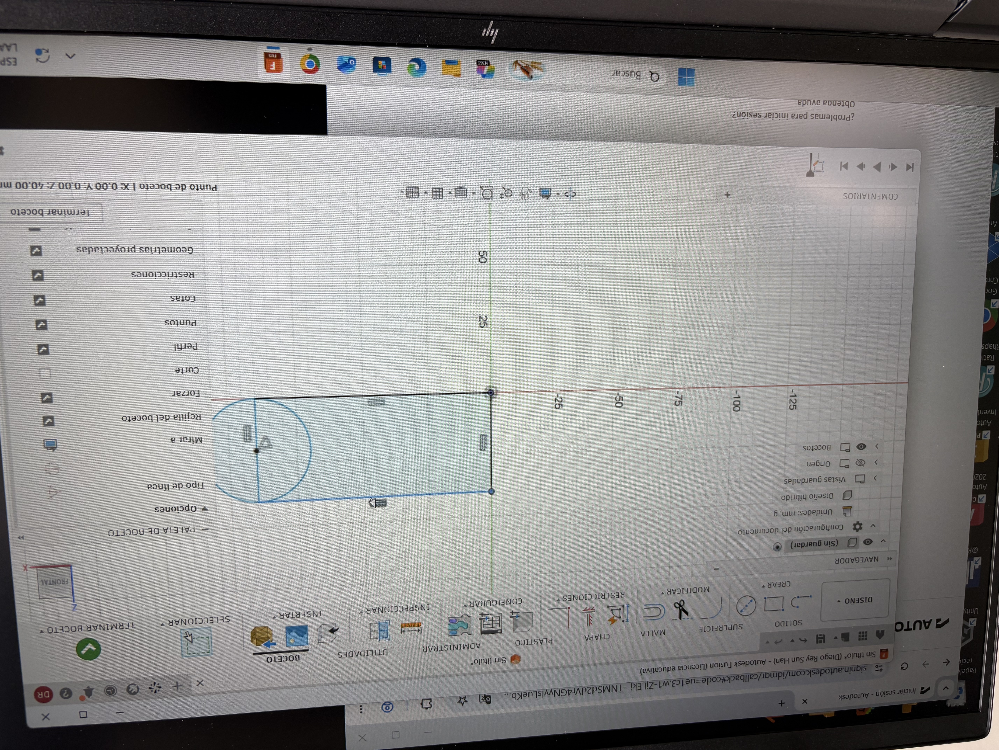

---
hide:
    - toc
---

# MT02-MT03
# **MT02 Mi primera pieza en 3D después de 20 años**

##Qué hice## El encargo era diseñar un objeto útil, de al menos dos piezas que encajen entre sí, con un logo o ícono en relieve. Al final, había que presentarlo en una lámina en PDF. Yo diseñé una bisagra: dos piezas que se unen y le dan movimiento al objeto. 

{ width="600" style="display: block; margin: auto" }

