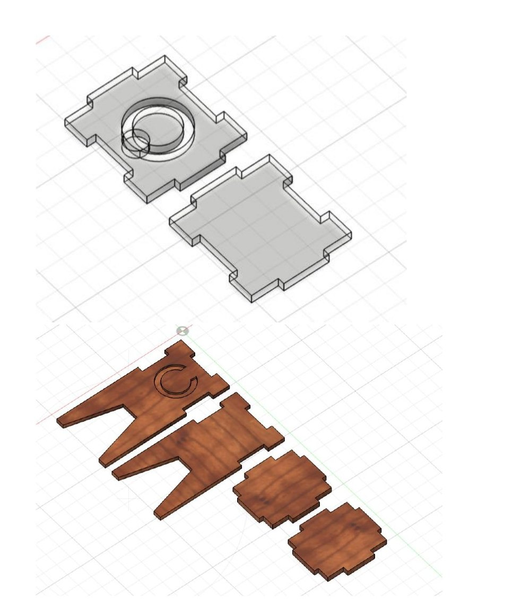
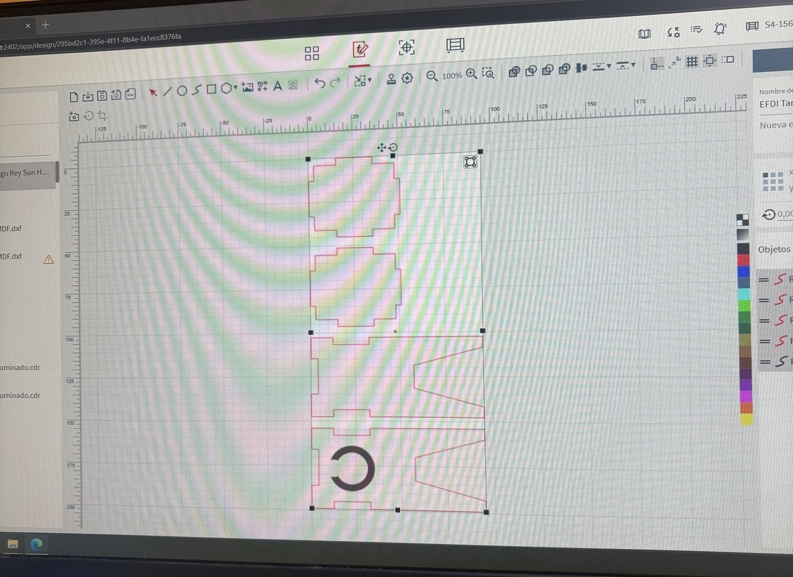
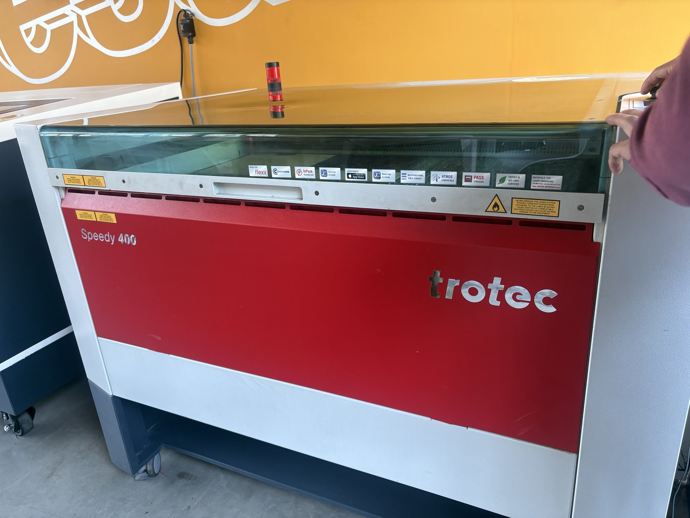
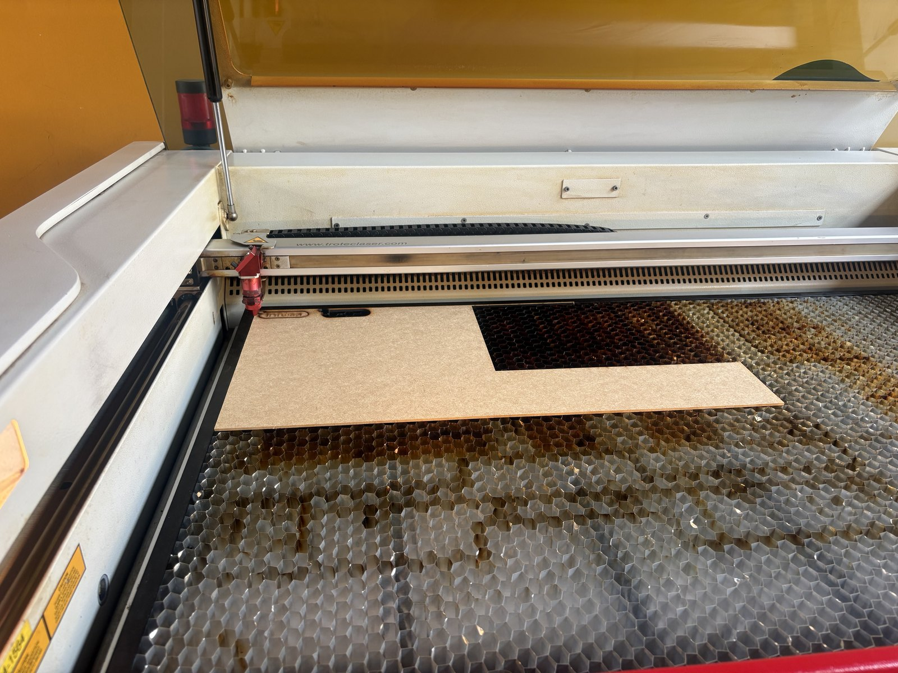
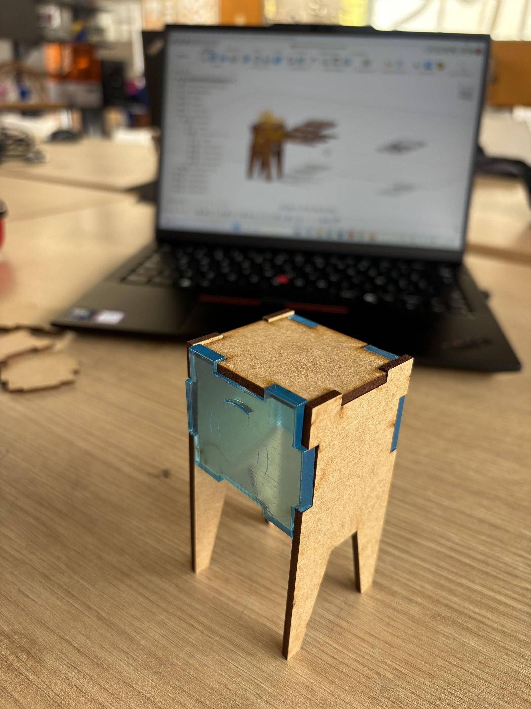

---
hide:
    - toc
---

# MT02
## **Mi primera pieza en 3D después de 20 años**

##**Veinte años**
El encargo era diseñar un objeto útil, de al menos dos piezas que encajen entre sí, con un logo en relieve, y presentarlo en una lámina PDF.
Soy ingeniero mecánico de formación. Hace veinte años esto habría sido rutina. Pero llevaba casi dos décadas sin abrir un programa de diseño, y de aquella formación me quedaba más intuición que oficio: sabía qué quería ver en pantalla, no cómo pedírselo al software.
Así que me puse dos metas en lugar de una. Cumplir con la tarea, por supuesto. Y, sobre todo, salir de ella con una base real en Fusion, para que esta no fuera una pieza suelta sino la primera de muchas. Quería retarme.
 

{ width="600" style="display: block; margin: auto" }

##**Donde me trabé**
El problema no era el concepto —tenía claro qué pieza quería— sino la traducción. Dónde está el comando. Por qué la restricción no sujeta el boceto. Por qué la extrusión sale hacia el lado que no es. Cada paso que en mi cabeza duraba un segundo me tomaba minutos de buscar y equivocarme. Encontrar los comandos en Fusion era un ida y vuelta con Gemini para pedirle que me ayude a usar el programa.

Después de varias vueltas tomé la decisión que terminó siendo la más importante del módulo: dejar de insistir solo.

##**El Fab Lab**
Fui al Fab Lab ESAN un miércoles. Era mi primera visita.
Jorge Valerio, que está a cargo, me mostró los equipos y me explicó lo básico de Fusion. Y me propuso algo que no se me habría ocurrido: hacer una bisagra.
Me gustó de inmediato. Una bisagra no es una pieza, son dos que tienen que convivir. Si el eje queda apretado, no gira. Si queda holgado, baila. Para un primer proyecto después de veinte años me pareció exigente, y justamente por eso, el correcto.

{ width="600" style="display: block; margin: auto" }

##**De la wincha al modelo**
Trabajé sobre una bisagra real que ya estaba impresa. La medí con wincha, sin ceremonia, y dibujé a mano alzada en mi cuaderno.
Ese boceto en papel fue el puente. Lo que llevaba dando vueltas en la cabeza por fin estaba afuera, con medidas y proporciones que podía mirar y corregir.

{ width="600" style="display: block; margin: auto" }

De ahí pasé al dibujo en 3D dentro de Fusion, y cuando hice la extrusión de la primera pieza, la tarea comenzó a tener forma. 

{ width="300" style="display: block; margin: auto" }

{ width="300" style="display: block; margin: auto" }

{ width="300" style="display: block; margin: auto" }

{ width="300" style="display: block; margin: auto" }

{ width="300" style="display: block; margin: auto" }

Visto desde el final, el proceso suena ordenado. Mientras ocurría no lo era.

##**El ícono prestado**
El encargo pedía un logo en relieve. No diseñé uno propio: descargué un SVG y lo llevé a Fusion para levantarlo sobre la pieza. Me costó encontrar una imagen en formato SVG y usé una de google que fue la única que encontré en ese formato. 

Fue una decisión, no un descuido. El ícono propio puede esperar al siguiente proyecto.

{ width="300" style="display: block; margin: auto" }

##**Tres horas**
Estuve cerca de tres horas con Jorge.
Fue difícil y, por momentos, frustrante. La herramienta era nueva y de lo que alguna vez supe de CAD no quedaba casi nada. Hubo ratos de dar vueltas sobre lo mismo sin avanzar.
Y al final, cuando las dos piezas encajaron, valió cada minuto. Es mi primera pieza diseñada en muchos años, y eso pesa más que su complejidad.

##**Lo que me llevo**
Me llevo comandos, flujos y atajos. Pero sobre todo me llevo una certeza que no es técnica: esto es práctica. Fusion no se entiende de una vez, se usa. La única forma de soltarme es volver a abrir el programa mañana, y pasado.
Y una segunda, que me costó más admitir: pedir ayuda acortó semanas. Tres horas al lado de alguien que ya sabe valieron más de lo que habría conseguido solo.

[Descargar la lámina (PDF)](../images/MT02/lamina.pdf)

#MT03
#**Mi primera pieza en corte láser**

##**Entusiasmado y perdido**
La tarea era diseñar la carcasa de una luminaria para cortar en láser. Solo piezas planas que encastren entre sí, sin tornillos ni pegamento, y usando las tres operaciones del láser: grabado raster, marcado sobre vector y corte.
Era mi primera pieza en láser, y la verdad es que estaba muy entusiasmado. Pero también bastante perdido.
Me pasó lo mismo que en el módulo anterior: no tengo base en Fusion y la clase avanzaba rápido. Lo que no me quedaba nada claro era el paso del medio, o sea cómo convertir un objeto 3D en algo editable que el software del láser pueda leer. Ese salto, que en clase parecía obvio, para mí no lo era.

##**La clase enseñaba un camino y el Fab Lab usa otro**
Hubo algo que me complicó todavía más. El proceso que explicaron en clase pasa por RDWorks, pero en el Fab Lab de ESAN, que es donde hago la práctica, no usan ese software. Tienen una Trotec con su propio programa.
Así que buena parte de lo explicado no me servía tal cual. Tenía que entender el proceso de fondo y después traducirlo a las herramientas que iba a tener delante.

##**Esta vez no esperé tanto**
Del módulo anterior me quedó un aprendizaje claro: no perder tiempo intentándolo solo. Así que fui directo al Fab Lab a trabajar con Jorge.
Me explicó cómo era el proceso y, a partir de ahí, me reté a hacerlo yo. Y lo logré, cosa que en algún momento pensé que no iba a pasar. Fue muy gratificante.

##**El diseño**
Diseñé la carcasa en Fusion. Es una estructura de capas con cuatro patas, con espacio adentro para los elementos lumínicos y un panel de acrílico en una de las caras.

{ width="600" style="display: block; margin: auto" }
<em style="color: gray; font-size: 12px">La luminaria armada, vista desde el modelo de Fusion.</em>

Todas las uniones son encastres. No hay un solo tornillo ni una gota de pegamento: lo que sostiene la pieza es la geometría.

{ width="600" style="display: block; margin: auto" }
<em style="color: gray; font-size: 12px">Las piezas por separado. Cada lengüeta tiene su ranura correspondiente.</em>

Después exporté los vectores en 2D y los llevé al software del láser del Fab Lab, donde se configura cada operación con su color.

{ width="600" style="display: block; margin: auto" }
<em style="color: gray; font-size: 12px">Los vectores ordenados por capas antes de mandar a cortar.</em>

##**El encastre no entraba**

Acá vino el aprendizaje más grande, y fue uno que no me esperaba.
La primera vez que corté, las piezas no encastraban. El láser se come una parte del material al cortar, así que la ranura termina siendo un poco distinta a lo que dibujaste. Eso en la pantalla no se ve.
Me tocó hacer varias pruebas, ajustar, volver a cortar y probar de nuevo, hasta que las piezas entraron.

{ width="600" style="display: block; margin: auto" }
<em style="color: gray; font-size: 12px">La Trotec Speedy 400 del Fab Lab ESAN.</em>

{ width="600" style="display: block; margin: auto" }
<em style="color: gray; font-size: 12px">La placa lista sobre la cama de la máquina.</em>

##**La tapa que no pude poner**

Con una pieza no lo logré. La tapa inferior nunca llegó a encajar bien y terminé armando la luminaria sin ella.
Me quedó con todas las capas menos esa. No es como la había dibujado, pero prefiero dejarlo documentado tal cual, porque es el tipo de detalle que se aprende cortando y no modelando.

{ width="600" style="display: block; margin: auto" }
<em style="color: gray; font-size: 12px">El resultado: MDF y acrílico, encastrado, sin la tapa inferior.</em>

Esa tarde estuve en el Fab Lab junto a otra compañera peruana que también está llevando la especialización. Se hace bastante más llevadero cuando no estás solo frente a la máquina.

##**Lo que me llevo**
Por el lado técnico, el proceso completo: pasar de un modelo 3D en Fusion a un archivo que la máquina pueda cortar. Ya sé dónde están los pasos y qué hace cada uno.
Lo otro, que para mí vale igual, es entender que entre el dibujo y la pieza real hay una distancia. El encastre que en Fusion calza perfecto, en el MDF no entra. Eso solo se aprende probando.
Y una confirmación de lo del módulo pasado: pedir ayuda al inicio me ahorró días. Jorge me explicó el camino en un rato y el resto lo pude hacer yo.

