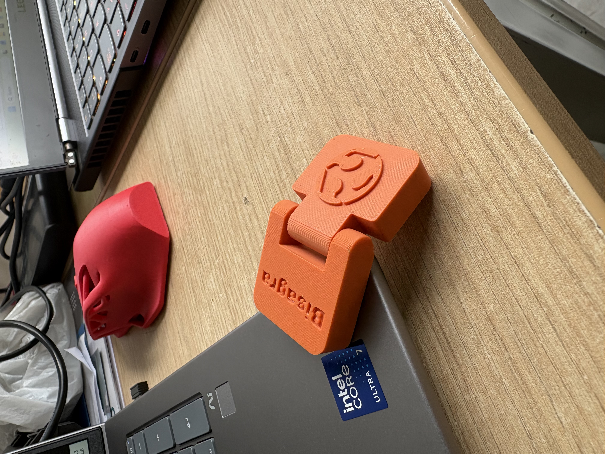
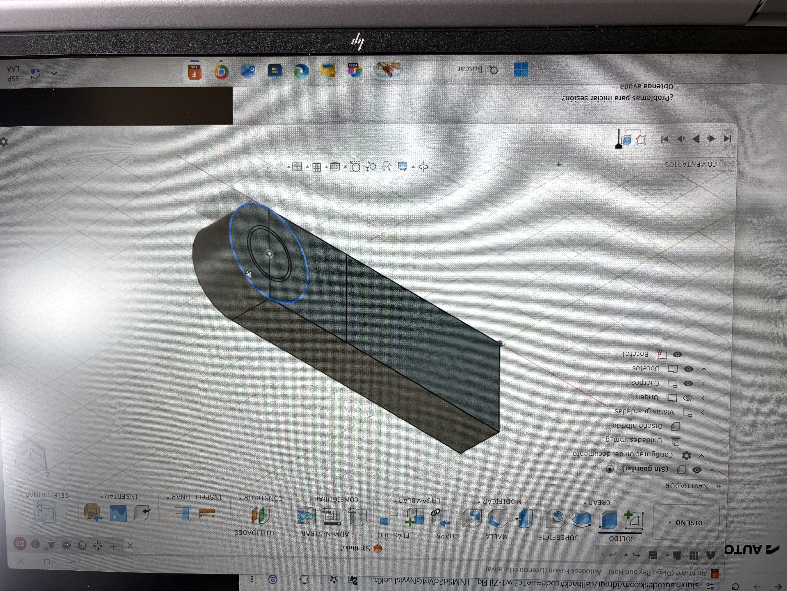
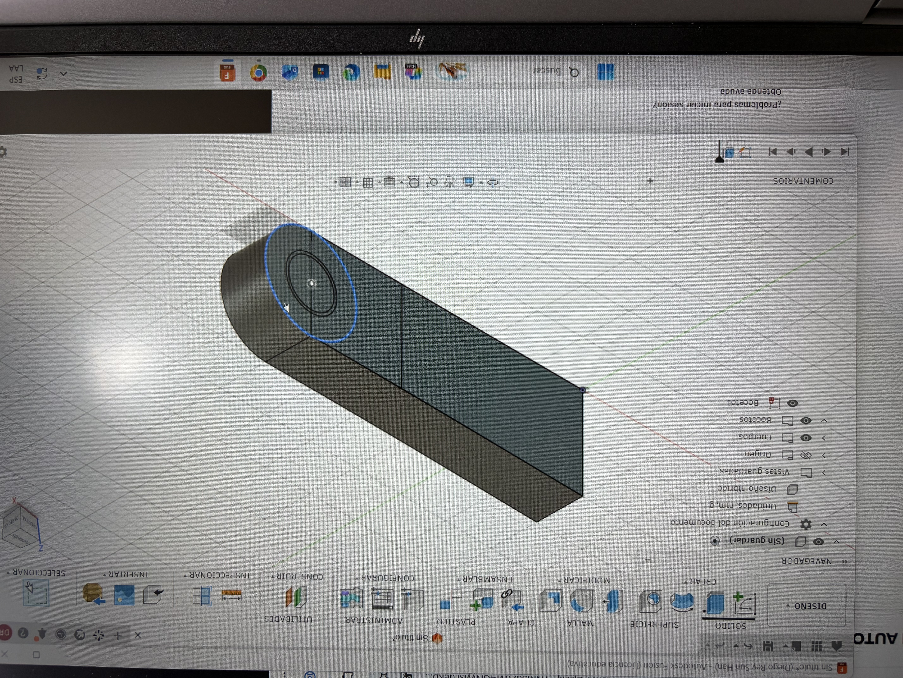
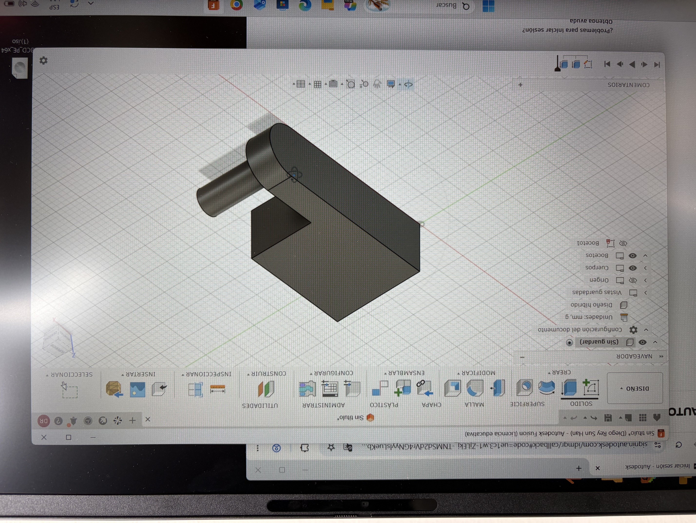
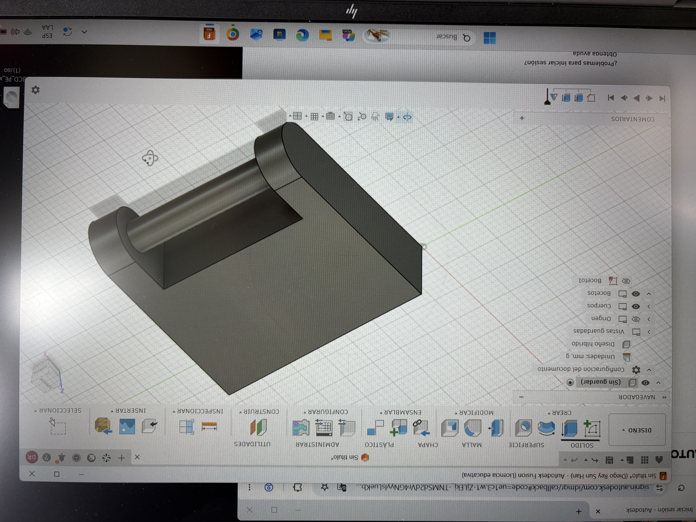
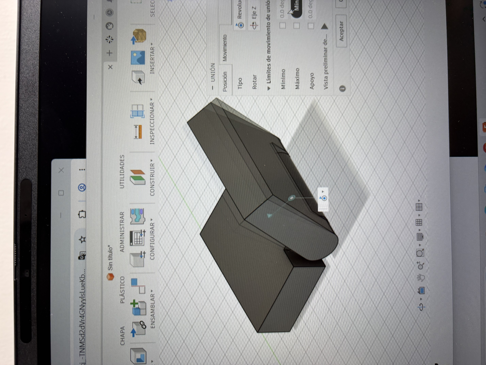
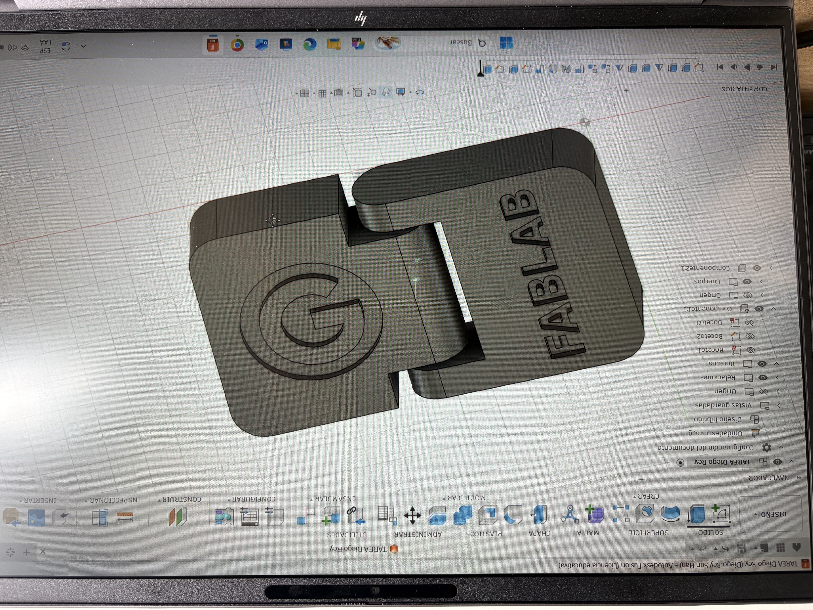

---
hide:
    - toc
---

# MT02-MT03
# **Mi primera pieza en 3D después de 20 años**

##Veinte años
El encargo era diseñar un objeto útil, de al menos dos piezas que encajen entre sí, con un logo en relieve, y presentarlo en una lámina PDF.
Soy ingeniero mecánico de formación. Hace veinte años esto habría sido rutina. Pero llevaba casi dos décadas sin abrir un programa de diseño, y de aquella formación me quedaba más intuición que oficio: sabía qué quería ver en pantalla, no cómo pedírselo al software.
Así que me puse dos metas en lugar de una. Cumplir con la tarea, por supuesto. Y, sobre todo, salir de ella con una base real en Fusion, para que esta no fuera una pieza suelta sino la primera de muchas. Quería retarme.
 

{ width="600" style="display: block; margin: auto" }

##Donde me trabé
El problema no era el concepto —tenía claro qué pieza quería— sino la traducción. Dónde está el comando. Por qué la restricción no sujeta el boceto. Por qué la extrusión sale hacia el lado que no es. Cada paso que en mi cabeza duraba un segundo me tomaba minutos de buscar y equivocarme. Encontrar los comandos en Fusion era un ida y vuelta con Gemini para pedirle que me ayude a usar el programa.

Después de varias vueltas tomé la decisión que terminó siendo la más importante del módulo: dejar de insistir solo.

##El Fab Lab
Fui al Fab Lab ESAN un miércoles. Era mi primera visita.
Jorge Valerio, que está a cargo, me mostró los equipos y me explicó lo básico de Fusion. Y me propuso algo que no se me habría ocurrido: hacer una bisagra.
Me gustó de inmediato. Una bisagra no es una pieza, son dos que tienen que convivir. Si el eje queda apretado, no gira. Si queda holgado, baila. Para un primer proyecto después de veinte años me pareció exigente, y justamente por eso, el correcto.

{ width="600" style="display: block; margin: auto" }

##De la wincha al modelo
Trabajé sobre una bisagra real que ya estaba impresa. La medí con wincha, sin ceremonia, y dibujé a mano alzada en mi cuaderno.
Ese boceto en papel fue el puente. Lo que llevaba dando vueltas en la cabeza por fin estaba afuera, con medidas y proporciones que podía mirar y corregir.

{ width="600" style="display: block; margin: auto" }

De ahí pasé al dibujo en 3D dentro de Fusion, y cuando hice la extrusión de la primera pieza, la tarea comenzó a tener forma. 

{ width="300" style="display: block; margin: auto" }

{ width="300" style="display: block; margin: auto" }

{ width="300" style="display: block; margin: auto" }

{ width="300" style="display: block; margin: auto" }

{ width="300" style="display: block; margin: auto" }

Visto desde el final, el proceso suena ordenado. Mientras ocurría no lo era.

##El ícono prestado
El encargo pedía un logo en relieve. No diseñé uno propio: descargué un SVG y lo llevé a Fusion para levantarlo sobre la pieza. Me costó encontrar una imagen en formato SVG y usé una de google que fue la única que encontré en ese formato. 

Fue una decisión, no un descuido. El ícono propio puede esperar al siguiente proyecto.

{ width="300" style="display: block; margin: auto" }

##Tres horas
Estuve cerca de tres horas con Jorge.
Fue difícil y, por momentos, frustrante. La herramienta era nueva y de lo que alguna vez supe de CAD no quedaba casi nada. Hubo ratos de dar vueltas sobre lo mismo sin avanzar.
Y al final, cuando las dos piezas encajaron, valió cada minuto. Es mi primera pieza diseñada en muchos años, y eso pesa más que su complejidad.

##Lo que me llevo
Me llevo comandos, flujos y atajos. Pero sobre todo me llevo una certeza que no es técnica: esto es práctica. Fusion no se entiende de una vez, se usa. La única forma de soltarme es volver a abrir el programa mañana, y pasado.
Y una segunda, que me costó más admitir: pedir ayuda acortó semanas. Tres horas al lado de alguien que ya sabe valieron más de lo que habría conseguido solo.

